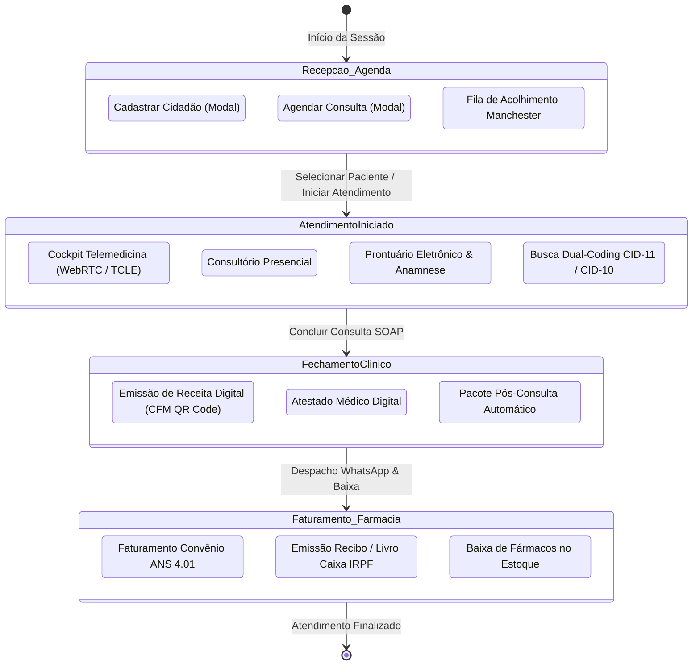
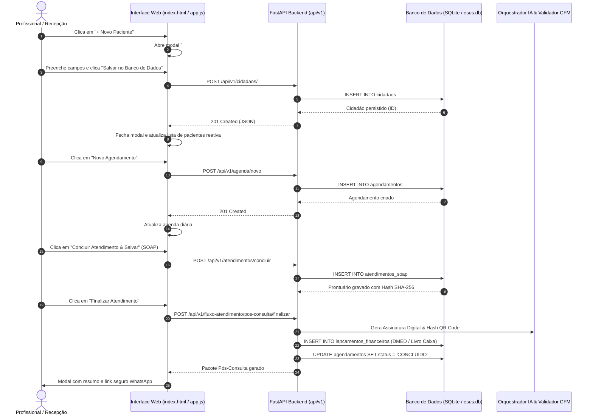

# Esquema Lógico, Arquitetura e Catálogo de Testes dos Botões do Cockpit MedIA

> **Referência Técnica MedIA**: Versão 2.4 - Outubro/2026.
> Cobre 100% dos botões da interface, seus respectivos tratadores JavaScript, rotas de API, persistência em banco de dados e testes automatizados.

---

## 1. Arquitetura Lógica e Máquina de Estados da Jornada Clínica

O sistema opera orientado a eventos centrados na jornada do paciente e na prática médica conforme as Resoluções CFM 2.314/2022, ANS TISS 4.01, Padrão OMS CID-11 e Receita Federal DMED.

---

## 2. Diagrama de Fluxo de Execução dos Botões

---

## 3. Catálogo Exaustivo e Dicionário de Botões

### 3.1. Barra de Navegação Superior e Controles Globais (Header)

| # | ID / Elemento | Rótulo / Ícone | Evento & Função JS | Endpoint API / Ação | Efeito no Banco / Estado |
| :---: | :--- | :--- | :--- | :--- | :--- |
| **01** | `btn-modo-presencial` | Presencial | `onclick="alternarModoTrabalho('presencial')"` | Alterna layout | Ajusta campos e visibilidade para consultório físico |
| **02** | `btn-modo-telemedicina` | Telemedicina | `onclick="alternarModoTrabalho('telemedicina')"` | Alterna layout | Exibe painel WebRTC, câmera, microfone e TCLE |
| **03** | `btn-tema` | Tema (Sol/Lua) | `onclick="alternarTema()"` | `localStorage` | Alterna modo Claro / Escuro (Dark Mode) |
| **04** | `btn-command-bar` | Comandos `Ctrl+K` | `window.medIACommandBar.toggle()` | UI Component | Abre barra universal de comando rápido |
| **05** | `btn-atalhos` | Teclado Clínico | `onclick="abrirModalAtalhos()"` | UI Modal | Exibe guia de atalhos rápidos do teclado |
| **06** | `badge-cfm` | CFM 2.314 Ativo | `onclick="abrirModalAuditoria()"` | UI Modal | Exibe trilha de conformidade LGPD e CFM |
| **07** | `btn-auditoria` | Trilha Auditoria | `onclick="abrirModalAuditoria()"` | UI Modal | Abre modal com registro das operações criptográficas |
| **08** | `btn-logout` | Sair | `onclick="fazerLogout()"` | `sessionStorage.clear()` | Encerra a sessão ativa e abre modal de login |
| **09** | `nav-agenda` | Agenda do Dia | `onclick="trocarAba('agenda')"` | `GET /api/v1/agenda/` | Carrega agendamentos da data do banco |
| **10** | `nav-telemedicina` | Telemedicina CFM | `onclick="trocarAba('telemedicina')"` | WebRTC Manager | Inicia pipeline de conferência WebRTC |
| **11** | `nav-prontuario` | Prontuário & SOAP | `onclick="trocarAba('prontuario')"` | `GET /api/v1/prontuario/` | Carrega histórico e evolução do paciente ativo |
| **12** | `nav-acolhimento` | Acolhimento & Fila | `onclick="trocarAba('acolhimento')"` | `GET /api/v1/fila/` | Exibe triagem e classificação Manchester |
| **13** | `nav-pacientes` | Meus Pacientes | `onclick="trocarAba('pacientes')"` | `GET /api/v1/cidadaos/` | Lista todos os cidadãos cadastrados no banco |
| **14** | `nav-convenios` | Convênios & TISS | `onclick="trocarAba('convenios')"` | `GET /api/v1/convenios/guias` | Lista guias de consulta ANS TISS 4.01 |
| **15** | `nav-farmacia` | Farmácia & Baixa | `onclick="trocarAba('farmacia')"` | `GET /api/v1/farmacia/catalogo` | Exibe estoque e catálogo Rename/Anvisa |
| **16** | `nav-analytics` | Analytics & KPIs | `onclick="trocarAba('analytics')"` | `GET /api/v1/analytics/kpis` | Renderiza taxa de no-show, espera e heatmap |
| **17** | `nav-honorarios` | Honorários & DMED | `onclick="trocarAba('honorarios')"` | `GET /api/v1/convenios/lancamentos` | Abre Livro Caixa digital e Carnê-Leão |

---

### 3.2. Aba Agenda Médica

| # | ID / Elemento | Rótulo / Ícone | Evento & Função JS | Endpoint API / Ação | Efeito no Banco / Estado |
| :---: | :--- | :--- | :--- | :--- | :--- |
| **18** | `filtro-todas` | Todas | `onclick="filtrarAgenda('TODAS')"` | Filtro local de exibição | Exibe agendamentos presenciais e virtuais |
| **19** | `filtro-presencial` | Presencial | `onclick="filtrarAgenda('PRESENCIAL')"` | Filtro local de exibição | Filtra atendimentos do consultório |
| **20** | `filtro-tele` | Telemedicina | `onclick="filtrarAgenda('TELEMEDICINA')"` | Filtro local de exibição | Filtra videochamadas |
| **21** | `btn-novo-agendamento`| + Novo Agendamento | `onclick="abrirModalNovoAgendamento()"` | UI Modal | Abre modal `#modal-novo-agendamento` |
| **D1** | (Grade da Agenda) | Atender Agora / Prontuário | `onclick="iniciarAtendimento(id)"` | `GET /api/v1/agenda/{id}` | Define paciente corrente e transiciona status |

---

### 3.3. Aba Telemedicina CFM HD

| # | ID / Elemento | Rótulo / Ícone | Evento & Função JS | Endpoint API / Ação | Efeito no Banco / Estado |
| :---: | :--- | :--- | :--- | :--- | :--- |
| **22** | `btn-copiar-link` | Copiar Link do Paciente | `onclick="copiarLinkPaciente()"` | Clipboard API | Copia URL da sala protegida de telemedicina |
| **23** | `btn-whatsapp-link` | Enviar WhatsApp | `onclick="enviarWhatsAppPaciente()"` | `window.open(wa.me)` | Dispara mensagem com link de acesso e PIN |
| **24** | `btn-medico-audio` | Microfone | `onclick="alternarAudioMedico()"` | `MediaStreamTrack.enabled` | Muta / desmuta o microfone do profissional |
| **25** | `btn-medico-video` | Câmera | `onclick="alternarVideoMedico()"` | `MediaStreamTrack.enabled` | Liga / desliga transmissão da câmera |
| **26** | `btn-share-screen` | Compartilhar Tela | `onclick="compartilharTela()"` | `navigator.mediaDevices.getDisplayMedia` | Transmite tela/exame para o paciente |
| **27** | `btn-converter` | Indicar Presencial | `onclick="acionarConversaoPresencial()"` | `PATCH /api/v1/agenda/{id}/status` | Registra necessidade de exame presencial |
| **28** | `btn-encerrar-tele` | Encerrar Teleconsulta | `onclick="finalizarTeleconsulta()"` | WebRTC Teardown | Fecha conexão P2P e transiciona para SOAP |
| **29** | `btn-tcle` | Visualizar TCLE | `onclick="visualizarTCLE()"` | UI Modal | Abre modal `#modal-tcle-view` com hash SHA-256 |
| **30** | `btn-ir-prontuario` | Ir para Prontuário | `onclick="transferirParaProntuario()"` | Sincroniza notas rápidas | Copia notas da teleconsulta para o SOAP |

---

### 3.4. Aba Prontuário & SOAP Multi-Especialidade

| # | ID / Elemento | Rótulo / Ícone | Evento & Função JS | Endpoint API / Ação | Efeito no Banco / Estado |
| :---: | :--- | :--- | :--- | :--- | :--- |
| **31** | `btn-top-receita` | Prescrição Digital QR Code | `onclick="emitirReceitaDigital()"` | UI Modal | Abre modal de prescrição CFM pré-preenchido |
| **32** | `btn-top-atestado` | Atestado Médico | `onclick="emitirAtestadoDigital()"` | UI Modal | Abre modal de emissão de atestado CFM |
| **33** | `btn-finalizar-fluxo`| Finalizar Atendimento | `onclick="finalizarAtendimentoComFluxo()"` | `POST /api/v1/fluxo-atendimento/pos-consulta/finalizar` | Escritura Livro Caixa, DMED e encerra agendamento |
| **34** | `btn-remover-diag` | [x] Remover Diagnóstico | `onclick="this.parentElement.remove()"` | DOM Mutation | Remove hipótese diagnóstica do chip |
| **35** | `btn-rx-padrao` | Receita com QR Code | `onclick="abrirModalPrescricaoDigital('SIMPLES')"` | UI Modal | Abre prescritor com modelo simples |
| **36** | `btn-rx-controlado`| 2 Vias (Controlados) | `onclick="abrirModalPrescricaoDigital('CONTROLE_ESPECIAL')"` | UI Modal | Abre prescritor com notificação de receita |
| **37** | `btn-atestado-cfm` | Atestado CFM | `onclick="abrirModalAtestadoDigital()"` | UI Modal | Abre emissor de atestado com CID selecionado |
| **38** | `btn-limpar-soap` | Limpar | `onclick="limparProntuario()"` | DOM Reset | Limpa campos SOAP com confirmação |
| **39** | `btn-concluir-soap` | Concluir Atendimento & Salvar | `onclick="concluirConsulta()"` | `POST /api/v1/atendimentos/concluir` | Grava atendimento SOAP no banco com hash |

---

### 3.5. Aba Acolhimento & Triagem Manchester

| # | ID / Elemento | Rótulo / Ícone | Evento & Função JS | Endpoint API / Ação | Efeito no Banco / Estado |
| :---: | :--- | :--- | :--- | :--- | :--- |
| **40** | `fila-espera-som` | Som: Ativado/Desativado | `onclick="alternarSom()"` | Web Audio API | Habilita sinal sonoro (ding-dong) na chamada |
| **41** | `btn-chamar-proximo`| Chamar Próximo | `onclick="window.filaEsperaPainel?.chamarProximo()"` | `POST /api/v1/fila/chamar` | Atualiza status para `CHAMADO` e toca áudio |
| **42** | `btn-atualizar-fila`| Atualizar | `onclick="window.filaEsperaPainel?.atualizar()"` | `GET /api/v1/fila/` | Recarrega fila do banco de dados |
| **43** | `btn-checkin-rapido`| Confirmar Entrada na Fila | `onclick="realizarCheckinRapido()"` | `POST /api/v1/fila/entrada` | Insere cidadão na fila com prioridade |

---

### 3.6. Aba Meus Pacientes

| # | ID / Elemento | Rótulo / Ícone | Evento & Função JS | Endpoint API / Ação | Efeito no Banco / Estado |
| :---: | :--- | :--- | :--- | :--- | :--- |
| **44** | `btn-novo-paciente` | + Novo Paciente | `onclick="abrirModalNovoPaciente()"` | UI Modal | Abre modal `#modal-novo-paciente` |
| **D2** | (Grade Pacientes) | Abrir Prontuário | `onclick="abrirProntuarioPaciente(id)"` | `GET /api/v1/cidadaos/{id}` | Carrega dados e transfere para a aba Prontuário |

---

### 3.7. Aba Convênios & Faturamento TISS ANS 4.01

| # | ID / Elemento | Rótulo / Ícone | Evento & Função JS | Endpoint API / Ação | Efeito no Banco / Estado |
| :---: | :--- | :--- | :--- | :--- | :--- |
| **45** | `btn-nova-guia-tiss`| Nova Guia de Consulta | `onclick="abrirModalNovaGuiaTISS()"` | UI Modal | Abre emissor de guia TISS |
| **46** | `btn-lote-xml-tiss` | Exportar Lote XML | `onclick="exportarLoteXMLTISS()"` | `POST /api/v1/tiss/exportar-lote-xml` | Baixa arquivo XML validado no schema ANS |
| **D3** | (Grade Guias) | Recibo | `onclick="abrirModalReciboTISS(id)"` | UI Modal | Abre recibo formatado da guia selecionada |
| **D4** | (Grade Guias) | XML TISS | `onclick="baixarXMLGuia(numero)"` | `POST /api/v1/tiss/gerar-guia-xml` | Baixa o XML individual da guia |

---

### 3.8. Aba Farmácia & Dispensação

| # | ID / Elemento | Rótulo / Ícone | Evento & Função JS | Endpoint API / Ação | Efeito no Banco / Estado |
| :---: | :--- | :--- | :--- | :--- | :--- |
| **47** | `btn-analisar-risco`| Analisar Risco | `onclick="testarInteracaoMedicamentosa()"` | `POST /api/v1/clinica/checar-interacoes` | Motor de interações medicamentosas Rename |
| **D5** | (Grade Farmácia) | Dispensar | `onclick="dispensarMedicamento(nome)"` | `POST /api/v1/farmacia/dispensar-rapido` | Decrementa estoque no banco e atualiza grade |

---

### 3.9. Aba Analytics & KPIs

| # | ID / Elemento | Rótulo / Ícone | Evento & Função JS | Endpoint API / Ação | Efeito no Banco / Estado |
| :---: | :--- | :--- | :--- | :--- | :--- |
| **48** | `btn-refresh-analytics`| Atualizar Dados | `onclick="carregarAnalytics()"` | `GET /api/v1/analytics/kpis` + heatmap | Recalcula indicadores operacionais e clínicos |

---

### 3.10. Aba Honorários & Livro Caixa / DMED IRPF

| # | ID / Elemento | Rótulo / Ícone | Evento & Função JS | Endpoint API / Ação | Efeito no Banco / Estado |
| :---: | :--- | :--- | :--- | :--- | :--- |
| **49** | `btn-gerar-dmed` | Gerar Arquivo DMED | `onclick="gerarLoteDMED()"` | `GET /api/v1/dmed/exportar-exemplo` | Baixa arquivo texto no padrão Receita Federal |
| **D6** | (Grade Honorários) | Recibo | `onclick="baixarReciboDMED(recibo)"` | `GET /api/v1/convenios/lancamentos` | Abre modal com o recibo oficial de prestação |

---

### 3.11. Modais de Ação e Confirmação

#### Modal: Novo Agendamento (`#modal-novo-agendamento`)
* **[50]** Fechar topo `[x]`: `fecharModalNovoAgendamento()`
* **[51]** Cancelar: `fecharModalNovoAgendamento()`
* **[52]** **Agendar Consulta**: `salvarNovoAgendamento()` -> Verifica/Cadastra paciente via `POST /api/v1/cidadaos/` se inexistente e cria agendamento via `POST /api/v1/agenda/novo`.

#### Modal: Novo Paciente (`#modal-novo-paciente`)
* **[53]** Fechar topo `[x]`: `fecharModalNovoPaciente()`
* **[54]** Cancelar: `fecharModalNovoPaciente()`
* **[55]** **Salvar no Banco de Dados**: `salvarNovoPaciente()` -> Grava cidadão com CPF, CNS, dados e comorbidades via `POST /api/v1/cidadaos/`.

#### Modal: Visualização de TCLE (`#modal-tcle-view`)
* **[56]** Fechar topo `[x]`: `fecharModalTCLE()`
* **[57]** Fechar rodapé: `fecharModalTCLE()`

#### Modal: Auditoria e Conformidade CFM (`#modal-auditoria`)
* **[58]** Fechar topo `[x]`: `fecharModalAuditoria()`
* **[59]** Fechar rodapé: `fecharModalAuditoria()`

#### Modal: Login e Troca de Perfil (`#modal-login`)
* **[60]** Dra. Francelli Versiani (Clínica Médica): `fazerLoginDemo(...)` -> Inicia sessão médica
* **[61]** Dr. Carlos Mendes (Cardiologia): `fazerLoginDemo(...)` -> Inicia sessão médica
* **[62]** Dra. Mariana Silveira (Psiquiatria): `fazerLoginDemo(...)` -> Inicia sessão médica
* **[63]** Recepção & Faturamento (Gestão): `fazerLoginDemo(...)` -> Inicia sessão administrativa
* **[64]** Entrar no Consultório (`type="submit"`): Submete credenciais customizadas

#### Modal: Recibo de Guia TISS (`#modal-recibo`)
* **[65]** Fechar topo `[x]`: `fecharModalRecibo()`
* **[66]** Imprimir / Salvar PDF: `window.print()`
* **[67]** Fechar rodapé: `fecharModalRecibo()`

#### Modal: Nova Guia TISS (`#modal-nova-guia-tiss`)
* **[68]** Fechar topo `[x]`: `fecharModalNovaGuiaTISS()`
* **[69]** Cancelar: `fecharModalNovaGuiaTISS()`
* **[70]** **Autorizar e Emitir Guia**: `salvarNovaGuiaTISS()` -> `POST /api/v1/convenios/guias/consulta`

#### Modal: Prescrição Digital CFM (`#modal-prescricao-digital`)
* **[71]** Fechar topo `[x]`: `fecharModalPrescricaoDigital()`
* **[72]** Copiar do Plano SOAP: `importarPrescricaoDoSOAP()` -> Extrai medicamentos do campo Conduta SOAP
* **[73]** Adicionar Fármaco: `adicionarLinhaMedicamento()` -> Insere nova linha de prescrição dinâmica
* **[74]** Copiar Link de Validação: `copiarLinkValidacaoPrescricao()` -> Copia URL pública do validador
* **[75]** Enviar WhatsApp: `enviarPrescricaoWhatsApp()` -> Abre API do WhatsApp com link e PIN
* **[76]** Fechar rodapé: `fecharModalPrescricaoDigital()`
* **[77]** **Gerar Prescrição PDF com QR Code**: `submeterEmissaoPrescricao()` -> `POST /api/v1/prescricao/emitir`

#### Modal: Atestado Médico Digital CFM (`#modal-atestado-digital`)
* **[78]** Fechar topo `[x]`: `fecharModalAtestadoDigital()`
* **[79]** Copiar Link de Validação: `copiarLinkValidacaoAtestado()`
* **[80]** WhatsApp: `enviarAtestadoWhatsApp()`
* **[81]** Fechar rodapé: `fecharModalAtestadoDigital()`
* **[82]** **Gerar Atestado PDF com QR Code**: `submeterEmissaoAtestado()` -> `POST /api/v1/atestados/emitir`

#### Modal: Recibo DMED e Livro Caixa (`#modal-recibo-dmed-view`)
* **[83]** Fechar topo `[x]`: `fecharModalReciboDMED()`
* **[84]** Fechar rodapé: `fecharModalReciboDMED()`
* **[85]** Imprimir Recibo: `window.print()`

#### Modal: Atalhos de Teclado (`#modal-atalhos`)
* **[86]** Fechar topo `[x]`: `fecharModalAtalhos()`
* **[87]** Entendido: `fecharModalAtalhos()`

---

## 4. Suíte de Testes Automatizados dos Botões (`test_botoes_cockpit.py`)

A suíte em [`backend/tests/test_botoes_cockpit.py`](../backend/tests/test_botoes_cockpit.py) garante contratualmente a saúde dos botões:

1. `test_todos_os_botoes_possuem_acao_ou_id`: Valida integridade do DOM do `index.html` (100% dos botões vinculados).
2. `test_funcoes_onclick_existem_no_javascript`: Valida declaração de todas as funções disparadas via `onclick`.
3. `test_botoes_modais_possuem_abertura_e_fechamento`: Impede modais bloqueantes ou sem ação de fechamento.
4. `test_fluxo_botao_salvar_novo_paciente_api`: Valida cadastro de cidadãos no SQLite.
5. `test_fluxo_botao_salvar_novo_agendamento_api`: Valida criação e vinculação de agendamentos.
6. `test_fluxo_botao_nova_guia_tiss_api`: Valida emissão de guias ANS TISS 4.01.
7. `test_fluxo_botao_dispensacao_farmacia_api`: Valida baixa farmacêutica e controle de saldo.
8. `test_fluxo_botao_finalizar_atendimento_pos_consulta_api`: Valida pacote pós-consulta, recibo DMED e livro caixa.
9. `test_fluxo_botao_exportar_lote_xml_tiss_api`: Valida arquivo XML para transmissão ANS.
10. `test_fluxo_botao_gerar_lote_dmed_api`: Valida arquivo magnético Receita Federal.

Resultado: **10/10 testes específicos aprovados (540 testes totais no backend sem erros)**.
